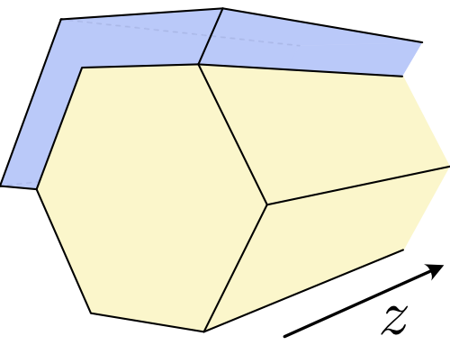
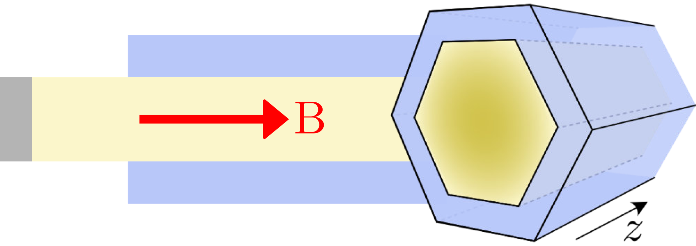
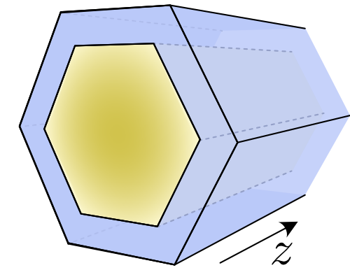

## PhD at ICMM-CSIC, Madrid: full-shell hybrid nanowires {.no-kicker}

:::: {.columns}
::: {.column width="52%"}
::: {.photo-map}
{.photo}
{.map}
:::

[Instituto de Ciencia de Materiales de Madrid (ICMM), CSIC]{.figcap}

**Carlos Payá** · PhD candidate · defence [March 2027]{.red .semibold}

[Thesis: full-shell hybrid nanowires. Caroli–de Gennes–Matricon analogs, Majoranas and Josephson junctions]{.small .ink2}
:::
::: {.column width="44%"}
#### PhD supervisors
::: {.avatars}
[Elsa Prada]{.avatar}
[Ramón Aguado]{.avatar}
:::

#### This work
::: {.avatars}
[César Robles<br>[MSc student]{.muted}]{.avatar}
[Pablo San-Jose<br>[Quantica.jl]{.muted}]{.avatar}
[Elsa Prada<br>[ICMM]{.muted}]{.avatar}
:::
:::
::::

::: {.notes}
(title, 0:20) Thank the organizers. Today: why tunneling spectroscopy in full-shell
nanowires cannot be fooled by quasi-Majoranas, the most common impostor of a Majorana zero
mode.

(0:30) PhD candidate at ICMM-CSIC in Madrid, supervised by Elsa Prada and Ramón Aguado;
defence in March 2027. My thesis is on full-shell hybrid nanowires: the Caroli–de
Gennes–Matricon analogs they host, their Majoranas and their Josephson junctions. This
work was done with César Robles, Pablo San-Jose (who develops Quantica.jl, the code behind
every figure today) and Elsa Prada.
:::

# The [quasi-Majorana]{.nowrap} problem {.part data-num="01" data-kicker="01 · Partial-shell nanowires" data-sub="Majorana zero modes, and the trivial zero modes that impersonate them"}

{.part-art}

::: {.notes}
(0:05) Part one: the Majorana nanowire and its most common impostor.
:::

## A nanowire turns topological above a critical Zeeman field

:::: {.columns}
::: {.column width="44%"}
Rashba nanowire, proximitized, in a Zeeman field:

::: {.eq}
$$
H = \Bigl[\tfrac{p_z^2}{2m^*} - \mu\Bigr]\tau_z + \alpha\, p_z \sigma_y \tau_z + V_\mathrm{Z}\,\sigma_z + \Delta\,\tau_x
$$
:::

::: {.fragment .qm-step}
- Gap at $k_z = 0$ closes at $V_\mathrm{Z}^\mathrm{c} = \sqrt{\Delta^2 + \mu^2}$
:::
::: {.fragment .qm-step}
- Reopens inverted: $Q = \operatorname{sign}\mathrm{Pf} = -1$, a Majorana zero mode (MZM) at each end
:::

::: {.fragment}
::: {.key}
**Class D**: one Hamiltonian with only particle–hole symmetry ($\mathcal{P}^2 = +1$) and a
$\mathbb{Z}_2$ index. All subbands live in it, and disorder cannot change the class.
:::
:::
:::
::: {.column width="54%"}
::: {.qm-widget data-widget="olbands" style="width:810px;height:560px"}
:::
:::
::::

::: {.refs}
R. M. Lutchyn *et al.* PRL **105**, 077001 (2010) · Y. Oreg *et al.* PRL **105**, 177002 (2010) · A. Kitaev, Phys. Usp. **44**, 131 (2001)
:::

::: {.notes}
(1:20) The Majorana nanowire you have seen this week: a Rashba semiconductor,
proximitized, under a Zeeman field (paper's partial-shell parameters, constant Δ here).
[click] As V_Z grows, the gap at k = 0 closes at V_Z^c = √(Δ² + μ²). [click] Beyond it,
it reopens inverted: the Pfaffian index flips sign and a Majorana sits at each end. The
inset is the phase diagram, the dot is our wire at μ_bulk. [click] I want to insist on the
symmetry: the full Hamiltonian of this wire is a single class-D Hamiltonian. Only
particle–hole symmetry, which is built into the BdG formalism, so disorder cannot remove
it: the class stays D. And every subband lives in that same Hamiltonian. (The strictly 1D
model has an extra chiral symmetry, BDI; it plays no role here.) Keep this in mind: it is
what changes in full shells. Drag the slider for questions.
:::

## A Majorana shows up as a zero-bias peak at the end of the wire

:::: {.columns .v-center}
::: {.column width="40%"}
- A normal probe tunnels into the end: $dI/dV \propto$ local DOS at $z = 0$
- Abrupt end ($\chi = 1$ nm): the bulk gap closes at $V_\mathrm{Z}^\mathrm{c}$ and a
  zero-bias peak (ZBP) follows

::: {.fragment}
::: {.key .plain}
A ZBP is **necessary but not sufficient**: trivial states can also stick to zero energy
:::
:::
:::
::: {.column width="56%"}
::: {.qm-widget data-widget="ldos-vb" data-chis="1" data-w="780" style="width:820px;height:520px"}
:::
:::
::::

::: {.refs}
V. Mourik *et al.* Science **336**, 1003 (2012) · E. Prada *et al.* Nat. Rev. Phys. **2**, 575 (2020) · end LDOS of the paper's wire with an abrupt end (illustrative)
:::

::: {.notes}
(0:40) What the tunnel probe sees is the local density of states at the end. With an
abrupt end, the bulk gap closes at V_Z^c and a zero-bias peak appears after it: the
textbook signature (paper's partial-shell wire, end of 1 nm; illustrative). [click] But
a zero-bias peak alone is not proof.
:::

## A smooth end makes the wire topological only locally

[The tunnel gate depletes the end; the potential heals over a length $\chi$: $\;\mu(z) = \mu_\mathrm{bulk}\bigl(1 - e^{-z/\chi}\bigr)$, topological wherever $V_\mathrm{Z} > \sqrt{\Delta^2 + \mu(z)^2}$]{.lead}

::: {.qm-widget data-widget="path" data-shell="partial" style="width:1440px;height:540px"}
:::

[]{.fragment .qm-step}
[]{.fragment .qm-step}

::: {.refs}
E. Prada *et al.* PRB **86**, 180503(R) (2012) · G. Kells *et al.* PRB **86**, 100503(R) (2012) · **C. Payá** *et al.* PRL **137**, 096606 (2026)
:::

::: {.notes}
(1:15) In a real device the tunnel gate depletes the end of the wire and the potential
heals smoothly over a length χ. Each point of the wire sits somewhere in the phase
diagram, so walking into the wire traces a vertical path: μ(z) goes from below zero
(insulating) up to μ_bulk. [click] Above V_Z^c, at V_Z^(1), the path goes straight from
insulating into topological: the whole wire is topological and the MZM sits at its end
(navy, it oscillates with k_F). [click] Below V_Z^c, at V_Z^(2), the path enters the
topological wedge and leaves it again at μ(z) ≈ 0.84 μ_bulk: only an island of length
≈ 1.9χ is topological. The island has two boundaries, and each hosts a Majorana
component. (Hover over the wire to see where each point sits in the diagram.)
:::

## Smooth ends pin the island's two Majoranas to zero

[$\Psi_\mathrm{L}$ sits at the hard end, $\Psi_\mathrm{R}$ at the soft edge of the island; their overlap splits the pair]{.lead}

::: {.qm-widget data-widget="qmzm" style="width:1440px;height:470px"}
:::

[]{.fragment .qm-step}

::: {.refs}
G. Kells *et al.* PRB **86**, 100503(R) (2012) · F. Peñaranda *et al.* PRB **98**, 235406 (2018) · wavefunctions: paper's routine for χ = 20–400 nm (illustrative)
:::

::: {.notes}
(1:15) Here is that pair for the paper's wire at V_Z^(2), computed with the paper's routine
for many χ. At χ = 50 nm the island is short: Ψ_R still reaches the end and overlaps the
large first lobes of Ψ_L, and the pair is split (right: its energy, ≈ 0.06 Δ0).
[click] Now make the end smoother. The island grows with χ, Ψ_R moves away and becomes a
smooth bump, the overlap with the oscillating Ψ_L averages out, and the splitting falls
exponentially: below 10⁻² Δ0 at χ ≈ 130 nm, ≈ 2×10⁻⁵ at 400 nm. The scale is
ħαμ_bulk/(V_Z Δ0) ≈ 0.2 µm here (Kells et al.). Two Majoranas at zero energy, but nothing
topological: a quasi-Majorana pair. (Densities normalized each to its own maximum. Press
play or drag the slider for questions.)
:::

## Same zero-bias peak, no topology: a false positive

:::: {.columns}
::: {.column width="52%"}
::: {.qm-widget data-widget="ldos-vb" data-chis="1,50,100,200" data-w="780" style="width:800px;height:520px"}
:::

[]{.fragment .qm-step}
[]{.fragment .qm-step}
[]{.fragment .qm-step}
:::
::: {.column width="46%"}
::: {.qm-widget data-widget="ldos-chi" data-rows="partial" data-tagstep="3" data-w="740" style="width:720px;height:320px"}
{.qm-asset data-key="device_partial"}
:::

::: {.fragment}
::: {.key .mt-2}
The quasi-MZM peak starts **before** the bulk transition and looks like a true MZM: local
spectroscopy cannot tell them apart
:::
:::

::: {.fragment}
[Can a different geometry defuse this false positive?]{.lead .semibold .navy}
:::
:::
::::

::: {.refs}
A. Vuik *et al.* SciPost Phys. **7**, 061 (2019) · C.-X. Liu *et al.* PRB **96**, 075161 (2017) · **C. Payá** *et al.* PRL **137**, 096606 (2026), Fig. 2(a, b)
:::

::: {.notes}
(1:00) What the probe actually sees as the end gets smoother: χ = 1, 50, 100 and the
published 200 nm. [click ×3] The zero-bias peak creeps into the trivial phase, from
≈ 0.7 V_Z^c for χ = 200 nm. Right, paper Fig. 2: versus smoothness, the true MZM (V_Z^(1))
gives a ZBP for any χ; the quasi-MZM (V_Z^(2)) is split for sharp ends and pins to zero
above 100–200 nm. [click] Same peak, no topology. Quasi-MZMs also reproduce quantized
peaks and 4π Josephson effects (Vuik et al.). [click] So: can a different geometry defuse
this?
:::

# Full-shell nanowires through the lens of symmetry {.part data-num="02" data-kicker="02 · Full-shell nanowires" data-sub="Two symmetry classes coexist, and the trivial one fills first"}

{.part-art}

::: {.notes}
(0:05) Part two: full-shell nanowires, from the point of view of symmetry.
:::

## In a full shell, topology is driven by the magnetic flux

:::: {.columns}
::: {.column width="34%"}
{width="100%"}

::: {.small}
- An axial field threads a flux $\Phi = \pi R^2 B$ through the shell
- The pairing $\Delta\, e^{in\varphi}$ winds $n = \lfloor \Phi/\Phi_0 \rceil$ times: **Little–Parks lobes**
- Topology driven by the flux (orbital effect + radial SOC) at $B \approx 0.1$ T, only in **odd lobes**
:::
:::
::: {.column width="64%"}
::: {.qm-widget data-widget="lp" style="width:960px;height:440px"}
:::

[]{.fragment .qm-step}
[]{.fragment .qm-step}

::: {.fragment .fade-up}
[Zero-bias peaks were seen in the first lobe (Vaitiekėnas *et al.* 2020), but other mechanisms also produce them]{.small .ink2}
:::
:::
::::

::: {.refs}
S. Vaitiekėnas *et al.* Science **367**, eaav3392 (2020) · **C. Payá** *et al.* PRB **109**, 115428 (2024) · M. Valentini *et al.* Science **373**, 82 (2021) · Little–Parks lobes of the paper's shell (illustrative)
:::

::: {.notes}
(1:00) The alternative: full-shell nanowires, where the superconductor wraps the whole core.
An axial field threads a flux, and the shell's order parameter winds n times around the
wire, n the fluxoid. [click] Sweep the flux: winding costs kinetic energy, the shell gap
shrinks away from integer flux and n jumps by one at half-integer flux, the Little–Parks
lobes. [click] The topological transition is driven by the flux, through the orbital
effect and the radial spin–orbit coupling, at fields of 0.1 T, and only in odd lobes.
Vaitiekėnas and coworkers saw zero-bias peaks in the first lobe in 2020; their origin is
debated.
:::

## The Hamiltonian splits into angular-momentum sectors

:::: {.columns}
::: {.column width="46%"}
::: {.eq}
$$
[H, J_z] = 0, \qquad J_z = -i\partial_\varphi + \tfrac{1}{2}\sigma_z + \tfrac{1}{2}n\,\tau_z
$$
:::

[$H = \bigoplus_{m_J} H_{m_J}$: one 2D problem in $(r, z)$ per sector, $m_J \in \mathbb{Z}$ in odd lobes]{.small}

::: {.fragment .qm-step}
[Particle–hole symmetry pairs **different** sectors:]{.small}

::: {.eq}
$$
\mathcal{P}\,H_{m_J}\,\mathcal{P}^{-1} = -H_{-m_J}
$$
:::
:::

::: {.fragment .qm-step}
::: {.symtable}
|   | inside the sector | class | 1D index |
|:--|:--|:--|:--|
| $m_J \neq 0$ | $T$ only ($H_{m_J}$ real) | [AI]{.chip .ink} | none: trivial |
| $m_J = 0$ | $T$, $\mathcal{P}$, chiral | [BDI]{.chip .red} | $\mathbb{Z}$: Majoranas |
| whole $H$ | $T$, $\mathcal{P}$ | BDI → D with disorder | |
:::
:::
:::
::: {.column width="52%"}
::: {.qm-widget data-widget="blocks" style="width:680px;height:420px"}
:::
:::
::::

::: {.refs}
P. San-Jose, **C. Payá** *et al.* PRB **107**, 155423 (2023) · **C. Payá** *et al.* PRB **109**, 115428 (2024) · A. Altland and M. Zirnbauer, PRB **55**, 1142 (1997)
:::

::: {.notes}
(1:15) In the cylindrical approximation the generalized angular momentum J_z — orbital,
spin and the winding of the pairing — is conserved, so H splits into independent sectors,
one per m_J. The whole wire is BDI (D once disorder breaks the cylinder). [click] But
particle–hole symmetry maps m_J to −m_J: it pairs different sectors. [click] So a sector
with m_J ≠ 0 has no particle–hole symmetry of its own. Its block is real, so it keeps a
time-reversal-like T = K: class AI, which has no topological index in 1D. These sectors
can only host trivial Andreev states. Only the self-conjugate sector m_J = 0 keeps 𝒫 and
is BDI: it is the only one that can host Majoranas, and it exists only in odd lobes.
Contrast with the partial shell: there, one class-D Hamiltonian holds all the subbands.
:::

## The trivial sectors are Andreev states of a synthetic vortex

:::: {.columns}
::: {.column width="40%"}
::: {.cartoons}


{.fragment}
:::

::: {.small}
- Abrikosov vortex: Caroli–de Gennes–Matricon states, $\delta E \sim \Delta^2/E_F$
- Full shell: the winding shell confines Andreev subbands in the core, **one per $m_J$**, with $\delta E \sim \Delta$: resolvable
:::
:::
::: {.column width="58%"}
::: {.expth-row}
::: {.stack}


:::

:::

[Lobe 0: hard gap. Lobes 1, 2: subgap states that disperse and skew with flux, one per $m_J$ subband]{.figcap}
:::
::::

::: {.refs}
C. Caroli, P. G. de Gennes, J. Matricon, Phys. Lett. **9**, 307 (1964) · P. San-Jose, **C. Payá** *et al.* PRB **107**, 155423 (2023) · M. T. Deng, **C. Payá** *et al.* PRL **134**, 206302 (2025)
:::

::: {.notes}
(1:00) What are those trivial sectors? A phase winding around a normal region is a vortex.
In an Abrikosov vortex, Andreev reflection off the pairing wall confines the CdGM states,
with tiny spacings Δ²/E_F. [click] The full shell is a synthetic vortex whose core is the
semiconductor: Andreev reflection at the core–shell interface confines subbands, one per
m_J, with spacings comparable to the gap. And we see them: tunneling spectroscopy on InAs/Al
full-shell wires from Copenhagen (left) and our model (right). Lobe 0 has a hard gap,
lobes 1 and 2 are full of discrete subgap states that disperse and skew with flux.
:::

## Two symmetry classes share zero energy

:::: {.columns}
::: {.column width="36%"}
::: {.fragment .qm-step}
- $m_J \neq 0$ (class AI): CdGM analogs fill every lobe with trivial subgap states
:::
::: {.fragment .qm-step}
- $m_J = 0$ (class BDI): the only sector that can host an MZM, and only in odd lobes
:::

::: {.fragment}
::: {.key}
The Majorana coexists with trivial CdGM analogs at zero energy: the topological phase is
generically **gapless**
:::
:::
:::
::: {.column width="62%"}
::: {.qm-widget data-widget="sectors" style="width:920px;height:560px"}
:::
:::
::::

::: {.refs}
**C. Payá** *et al.* PRB **109**, 115428 (2024) · F. Peñaranda *et al.* PRR **2**, 023171 (2020) · DOS of the paper's wire, χ = 1 µm: paper Fig. 1(g)
:::

::: {.notes}
(1:00) The DOS of our device (paper Fig. 1g): Little–Parks lobes filled with CdGM analogs.
[click] Split it by sector: in grey-blue the m_J ≠ 0 sectors, class AI, which fill every
lobe. [click] In red the m_J = 0 sector, class BDI: it exists only in the odd lobe, and
that is where the Majorana lives. [click] So the Majorana has to share zero energy with
trivial CdGM analogs of other sectors: two symmetry classes coexist, and the topological
phase is gapless.
:::

## The trivial sectors fill first: topology needs $\mu > \mu^\mathrm{ts}$

::: {.qm-widget data-widget="filling" style="width:1440px;height:600px"}
:::

[]{.fragment .qm-step}
[]{.fragment .qm-step}

::: {.refs}
**C. Payá** *et al.* PRL **137**, 096606 (2026), End Matter B and Fig. 4 (schematic, $k_z = 0$, $\Phi = \Phi_0/2$, radial mode $m_r = 1$)
:::

::: {.notes}
(1:30) This is the key difference, and it comes from that coexistence. Fill the bands, as
happens when walking into the wire from its depleted end. [click] Partial shell (left):
all subbands belong to the same class-D Hamiltonian, so whichever fills first can turn
topological right above depletion: the ordering of the bands is irrelevant. Full shell
(right): normal-state angular subbands at k_z = 0 versus m_L. The radial spin–orbit
coupling shifts the parabolas, so the band bottom is not at the m_J = 0 pair (red): the
class-AI CdGM sectors are populated first, and they are trivial. [click] Topology needs
μ above the threshold μ^ts, where the BDI pair fills. Along the wire (bottom strip), the
stretch where μ(z) < μ^ts is trivial: the trivial skin. (In our wire the threshold comes
from the second radial mode, ≈ 22 meV, because the first one needs unrealistic SOC.)
:::

# Smooth confinement in full shells {.part data-num="03" data-kicker="03 · Smooth confinement in full shells" data-sub="The length that creates quasi-Majoranas also hides them"}

{.part-art}

::: {.notes}
(0:05) Part three: now we bring back the smooth end, in the full shell.
:::

## In a grounded shell the gate potential still heals over $\chi$

[Laplace equation in the core, with $\phi_g(R, z) = 0$ on the shell and the gate depleting the end:]{.lead}

::: {.eq}
$$
e\phi_g(r, z) = \mu_\mathrm{bulk} \sum_{\nu = 1}^{\infty}\frac{2}{k_\nu J_1(k_\nu)}\, J_0\!\Bigl(k_\nu \frac{r}{R}\Bigr)\, e^{-k_\nu z / k_1 \chi}
$$
:::

::: {.qm-widget data-widget="potential" style="width:1380px;height:390px"}
:::

[The slowest Bessel mode sets $\chi$ ($R/k_1$ without screening; a free parameter)]{.figcap}

::: {.refs}
**C. Payá** *et al.* PRL **137**, 096606 (2026), End Matter A
:::

::: {.notes}
(0:40) The same smooth confinement in a full shell. The grounded shell screens external
gates, so their potential only enters through the uncovered end; Laplace's equation in the
core gives a sum of evanescent Bessel modes, zero at the shell. The slowest sets the
length χ, which we keep as a free parameter because screening makes it longer. Projected
on the mode that can turn topological, μ(z) heals like the partial-shell profile (right):
χ plays the same role in both geometries.
:::

## $\mu(z)$ must cross a trivial skin before turning topological

[Same construction as in partial shells, now in flux within lobe 1]{.lead}

::: {.qm-widget data-widget="path" data-shell="full" style="width:1440px;height:540px"}
:::

[]{.fragment .qm-step}
[]{.fragment .qm-step}

::: {.fragment}
[Inverted in flux: MZM below $\Phi^\mathrm{c}$, quasi-MZM above (the effective Zeeman energy falls with $\Phi$ within a lobe)]{.small .ink2}
:::

::: {.refs}
**C. Payá**, C. Robles, P. San-Jose, E. Prada, PRL **137**, 096606 (2026), Fig. 1(d, f)
:::

::: {.notes}
(1:15) Again μ(z) traces a vertical path, now in the flux–μ phase diagram of lobe 1
(schematic μ axis: the topological window μ^ts → μ_bulk is only 3 % wide). [click] MZM
case, Φ^(1): the path does not enter the topological region directly; it first crosses
the trivial region below μ^ts: the trivial skin, ≈ 3.4χ wide. The MZM sits behind it.
[click] Quasi-MZM case, Φ^(2): skin up to 3.5χ, a topological segment up to 7χ, and the
two quasi-MZMs form at its edges. [click] Note the inversion: here the MZM is at the lower
flux and the quasi-MZM at the higher one (backup slide).
:::

## Quasi-Majoranas still form in full shells, but deep inside the wire

:::: {.columns .v-center}
::: {.column width="44%"}
::: {.qm-widget data-widget="dos-zoom" style="width:640px;height:480px"}
:::
:::
::: {.column width="52%"}
- $m_J = 0$ DOS where $\mu(z)$ varies: MZM peak below $\Phi^\mathrm{c}$, quasi-MZM peak above it, pinned to zero
- A skin $\approx 3.5\chi$ wide separates the probe from the MZM **and** from the quasi-MZM pair ($3.5\chi$ to $7\chi$)

::: {.key .green}
The impostor exists, with exponentially small splitting, but it lives behind the skin
:::
:::
::::

::: {.refs}
**C. Payá** *et al.* PRL **137**, 096606 (2026), Fig. 1(h), $\chi = 1$ µm
:::

::: {.notes}
(0:45) They are real: the m_J = 0 DOS, integrated where μ(z) varies, shows the MZM peak
below Φ^c and the quasi-MZM peak above it, pinned to zero with an exponentially small
splitting. So quasi-Majoranas do form in full shells. But they form behind the skin.
:::

## The probe sees no quasi-Majorana: no false positives in full shells

::: {.qm-widget data-widget="ldos-chi" data-rows="partial,full" style="width:1400px;height:560px"}
{.qm-asset data-key="device_partial"}
{.qm-asset data-key="device_full"}
:::

[]{.fragment .qm-step}
[]{.fragment .qm-step}
[]{.fragment .qm-step}

::: {.refs}
**C. Payá** *et al.* PRL **137**, 096606 (2026), Fig. 2 · hidden quasi-MZM energy: lowest pole of the closed wire (poster calculation)
:::

::: {.notes}
(1:30) The key result: end LDOS versus smoothness. Partial shell, as before: the MZM gives a
ZBP for any χ and the quasi-MZM pins to zero for smooth ends: a false positive. [click]
Full shell, true MZM: visible for sharp ends, but the skin grows with χ and the end signal
is gone beyond ≈ 19 nm. Quasi-MZM: split states for very sharp ends, and then nothing.
[click] So: sharp end, the probe works; smooth end, the trivial skin hides everything.
No false positive. [click] And the quasi-MZM is there: dashed, its energy computed in a
closed wire. It pins to zero exactly where the end LDOS is dark.
:::

## One length scale both pins the impostor and buries it

::: {.qm-widget data-widget="window" style="width:1400px;height:560px"}
:::

[]{.fragment .qm-step}
[]{.fragment .qm-step}

::: {.refs}
Pinned: $E < 10^{-2}\Delta_0$ (split end-LDOS peak, or lowest pole of the closed wire). Visible: end LDOS above 1 % of its maximum. Data of paper Fig. 2 and the poster.
:::

::: {.notes}
(1:00) Why can't we escape this? Pinning a quasi-MZM needs a smooth end: χ large compared
with the Majorana length. Partial shell: pinned from χ ≈ 130 nm, and it stays visible at
the end for every χ: the two windows overlap, and that overlap is the false positive.
[click] Full shell: the same χ also sets the width of the trivial skin, ≈ 3.5χ. Visibility
dies at ≈ 19 nm, and the hidden pair only becomes a pinned bound state from ≈ 220 nm.
[click] There is no window where it is both pinned and visible: the scale that produces
the skin is the scale that controls what the probe sees. Quasi-Majoranas cannot be false
positives in full shells.
:::

## The conclusion survives disorder and temperature

::: {.qm-widget data-widget="ldos-chi" data-set="dis" data-rows="partial,full" style="width:1400px;height:560px"}
{.qm-asset data-key="device_partial"}
{.qm-asset data-key="device_full"}
:::

[]{.fragment .qm-step}

::: {.fragment}
[Short-range disorder below the minigap: MZM peaks survive; quasi-MZM peaks smear out (partial) or never reach the end (full). The same holds for the conductance with all $m_J$ sectors and finite temperature (Suppl. S-IV, S-V).]{.small .ink2}
:::

::: {.refs}
**C. Payá** *et al.* PRL **137**, 096606 (2026), Fig. 3 and Supplemental Material
:::

::: {.notes}
(0:40) Two checks. With short-range disorder below the minigap (paper Fig. 3), true MZM
peaks survive in both geometries; the quasi-MZM peak is smeared in the partial shell
[click] and in the full shell nothing reaches the end. The tunneling conductance including
all angular sectors and finite temperatures gives the same picture (Supplemental Material).
:::

## Conclusions

:::: {.columns}
::: {.column width="55%"}
::: {.conc}


**Partial shells**: one class-D Hamiltonian. Smooth confinement creates quasi-MZMs that
the local probe cannot tell from MZMs
:::

::: {.conc .fragment .fade-up}


**Full shells**: class-AI CdGM sectors coexist with the BDI $m_J = 0$ sector and fill
first, so $\mu(z)$ crosses a **trivial skin** $\approx 3.5\chi$
:::

::: {.conc .fragment .fade-up}


The same $\chi$ pins the impostor and buries it: **no quasi-MZM false positives**
:::
:::
::: {.column width="41%"}
#### Outlook {.red}
::: {.small}
- **A ZBP in a full shell** cannot be a quasi-MZM. Other trivial origins (e.g. flux-tunable Andreev states) must still be excluded
- **No ZBP**: the skin buries true MZMs too. Sharp barriers give the most informative measurements
- Beyond tunneling: CdGM analogs also leave fingerprints in the Josephson critical current (**CP** *et al.* arXiv:2607.18371)
:::
:::
::::

::: {.fragment}
::: {.key .mt-2}
In full-shell nanowires, the smooth potential that creates Majorana impostors also hides them
:::
:::

::: {.notes}
(1:15) To conclude. In partial shells, one class-D Hamiltonian, and smooth confinement
creates quasi-Majoranas that local spectroscopy cannot tell from MZMs. [click] Full shells
are synthetic vortices: trivial CdGM sectors coexist with the BDI m_J = 0 sector and fill
first, so μ(z) has to cross a trivial skin before reaching the topological phase. [click]
The skin grows with the same χ that pins the impostor, so it hides it. If you see a ZBP in
a full shell, it is not a quasi-Majorana, although flux-tunable Andreev states and other
mechanisms still have to be excluded. If you don't see one, the skin may be hiding a true
MZM: sharp barriers are the way to go. [click] Thank you.
:::

## Thank you {.no-kicker .thanks}

:::: {.columns}
::: {.column width="56%"}
::: {.avatars .big}
[César Robles]{.avatar}
[Pablo San-Jose]{.avatar}
[Elsa Prada]{.avatar}
:::

[carlosp24.github.io · carlos.paya@csic.es]{.lead .navy}

[Code and data: github.com/CarlosP24/SP72_AbsenceQM · built on Quantica.jl and FullShell.jl]{.small .muted}
:::
::: {.column width="38%"}
::: {.qr}


[*Phys. Rev. Lett.* **137**, 096606 (2026)]{.semibold}<br>[doi.org/10.1103/w9tp-3bbq]{.small .muted}
:::
:::
::::

::: {.funding}


[PID2021-125343NB-I00, PRE2022-101362, PID2023-150224NB-I00 and CEX2024-001445-S, funded by MICIU/AEI/10.13039/501100011033, “ERDF A way of making Europe” and “ESF+”]{.tiny .muted}
:::

::: {.notes}
Questions. Backup slides: why the transition is inverted in flux, models and parameters,
skin widths, origin of the skin for m_r = 0 vs 1, conductance and temperature, and the
Quantica.jl code of the partial-shell wire.
:::

# Backup {.part data-num="+" data-kicker="Backup" data-sub="Inversion in flux · parameters · skin widths · conductance"}

## Why the transition is inverted in flux

:::: {.columns}
::: {.column width="46%"}
- Partial shell: $V_\mathrm{Z}$ grows with $B$: trivial, then topological above $V_\mathrm{Z}^\mathrm{c}$
- Full shell, $m_J = 0$: a Majorana nanowire whose Zeeman energy is mostly **orbital**

::: {.eq}
$$
V_\mathrm{Z}^\mathrm{eff} = V_\mathrm{Z} + \frac{\tilde\phi}{2}\Bigl(\omega_R + \frac{\alpha}{R_\mathrm{av}}\Bigr), \qquad \tilde\phi = n - \frac{R_\mathrm{av}^2}{R_\mathrm{LP}^2}\frac{\Phi}{\Phi_0}
$$
:::

- Topological if $V_\mathrm{Z}^\mathrm{eff} > \sqrt{\Gamma_S^2 + \tilde\mu_0^2}$. Within a lobe $V_\mathrm{Z}^\mathrm{eff}$ **falls** with $\Phi$: MZM at low flux, quasi-MZM at high flux
:::
::: {.column width="52%"}
::: {.stack}


:::
:::
::::

::: {.refs}
S. Vaitiekėnas *et al.* Science **367**, eaav3392 (2020) · **C. Payá** *et al.* PRB **109**, 115428 (2024)
:::

## Models and parameters

| | Partial shell (1D, Suppl. S-I) | Full shell (Suppl. S-II) |
|:--|:--|:--|
| Common | $m^* = 0.023\,m_e$, $\Delta_0 = 0.23$ meV | $m^* = 0.023\,m_e$, $\Delta_0 = 0.23$ meV |
| Filling, SOC | $\mu_\mathrm{bulk} = 2$ meV, $\alpha = 40$ meV nm | $\mu_\mathrm{bulk} = 22.8$ meV, $\Delta U = 60$ meV, $\langle\alpha\rangle = 7$ meV nm |
| Coupling | $\Gamma_\mathrm{NS} = 3\Delta_0$, $V_C = 2V_\mathrm{Z}^\mathrm{c}$ | $\Gamma_\mathrm{NS} = 40\Delta_0$, $g = 10$ |
| Geometry | — | $R = 70$ nm, $d = 10$ nm, $\xi_d = 70$ nm |
| Smoothness (Fig. 1) | $\chi = 200$ nm | $\chi = 1$ µm |
| Disorder (Fig. 3) | $A_\mathrm{imp}/\sqrt{N} = 0.32\Delta_0$ | $A_\mathrm{imp}/\sqrt{N} = 0.02\Delta_0$ |

[Full shell: solid InAs-like core with a dome-shaped potential $U(r)$, radial Rashba SOC, flux and Zeeman; the Al shell is integrated out into a Little–Parks (Abrikosov–Gor'kov) self-energy; solved per $m_J$ sector.]{.small .ink2}

::: {.refs}
**C. Payá** *et al.* PRL **137**, 096606 (2026), End Matter C and Supplemental Material
:::

## Electrostatics and skin widths

:::: {.columns}
::: {.column width="48%"}
Projected on the $m_J = 0$, $m_r = 1$ mode that turns topological:

::: {.eq}
$$
\mu(z) \simeq \mu_\mathrm{bulk}\bigl(1 - 0.85\, e^{-z/\chi}\bigr)
$$
:::

| Case | Local phases along the wire |
|:--|:--|
| Partial, $V_\mathrm{Z}^{(2)}$ | topological for $z < 1.86\chi$, trivial beyond |
| Full, $\Phi^{(1)}$ | skin for $z < 3.42\chi$, then topological |
| Full, $\Phi^{(2)}$ | skin for $z < 3.50\chi$, topological up to $7.01\chi$ |

[Full-shell end signal below 1 % of its maximum for $\chi > 19$ nm (MZM and quasi-MZM)]{.small .ink2}
:::
::: {.column width="48%"}
{width="100%"}

[Phase diagram vs $\mu$ and $\langle\alpha\rangle$ at $\Phi = \Phi_0/2$, with the thresholds of the $m_r = 0$ and $m_r = 1$ modes (paper Fig. 4c)]{.figcap}
:::
::::

::: {.refs}
**C. Payá** *et al.* PRL **137**, 096606 (2026), End Matter A, B
:::

## Origin of the skin: radial modes $m_r = 0$ and $1$

{.center-img width="1100px"}

::: {.refs}
**C. Payá** *et al.* PRL **137**, 096606 (2026), Fig. 4
:::

::: {.notes}
Paper Fig. 4: band filling for the first and second radial modes, and the phase diagram
versus μ and ⟨α⟩ with the two thresholds. If asked about the axis: m_L here is the
eigenvalue of L_z = −i∂_φ + σ_z/2, half-integer (the m_J = 0 pair is m_L = ±1/2); the
"m_L ∈ ℤ" label of the published figure is a slip.
:::

## Conductance with all $m_J$ sectors, and temperature

:::: {.columns}
::: {.column width="49%"}
{width="100%"}
:::
::: {.column width="49%"}
{width="100%"}
:::
::::

::: {.refs}
**C. Payá** *et al.* PRL **137**, 096606 (2026), Supplemental Material S-IV, S-V (computed at negative bias and mirrored)
:::

## Reproduce it: the partial-shell wire in Quantica.jl

```{.julia code-line-numbers="|3-4|6-8|10-12|14-15"}
lat = LP.square(; a0) |> supercell((1, 0))         # 1D chain, a0 = 5 nm

p2 = @onsite((r; μ = μ) -> σ0τz * (2t - μ)) +       # kinetic energy
     hopping((r, dr) -> -t * σ0τz, range = a0)

rashba = @hopping((r, dr; α = α) ->                  # Rashba SOC
     α * im * dr[1] / (2a0^2) * σyτz, range = a0)
zeeman = @onsite((; B = B) -> σzτ0 * B)              # Zeeman

hSM = lat |> hamiltonian(p2 + rashba + zeeman; orbitals = Val(4))
Σ! = @onsite!((o; ω = 0, B = B) -> o + τΓ * ΣSC(Δ0 * Δf(B; Bc), ω))
hSC = hSM |> Σ!                                      # proximity self-energy

h, L = build_barrier(hSC, pw, χ)                     # smooth end, μ(z)
g = h |> attach(gSC; region = r -> r[1] == L) |> greenfunction()
```

[`src/builders/apartial.jl` and `barrier.jl` in the paper's repository; the full shell uses `FullShell.build_cyl`]{.small .muted}
